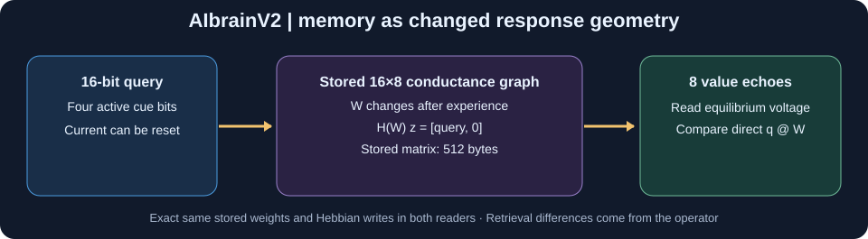

# AIbrainV2 — Queryable response geometry

Part of monday madness - 8 repos mostly consolidated to Sihtibrain. 



**Can experience change how a system answers a query, without continuously maintaining an activation?** This small, CPU-only associative-memory laboratory makes that idea testable.

Input a 16-bit cue (four active bits). Store one of eight labels in a **16×8 conductance matrix**. A graph reader injects the cue into a passive network and asks which of eight value nodes responds most strongly. A direct fast-weight reader uses **the exact same 512 bytes** and **the exact same Hebbian write operations**, but reads with `cue @ W`. A packed indexed lookup is a strong alternative, with its actual storage footprint shown.

This is deliberately **not** an artificial brain simulator or an unsupervised object segmenter. The architecture follows the most solid part of the SihtiBrain lineage: local changes can persist in a response operator and be revealed by a later query.

## Run it

Requires Python 3.10+:

```bash
python -m pip install -r requirements.txt
python -m unittest discover -s tests -v
python demo.py --output runs/operator_gate1
python gui.py
```

On Windows, double-click `run_gui.bat` after installing dependencies.

In the GUI, choose **exactly four** blue cue squares and a value 0–7, then **Write association**. Try **Query**, **Swap cue bit**, and writing a *different* value to the same cue. **Reset activity** leaves the connection memory intact; **Erase all connections** removes it. The graph and direct weights always receive identical writes. The indexed baseline deliberately overwrites that key.

## Gate 1: preregistered experiment

[Precommit protocol](docs/GATE1_PROTOCOL.md) · [Full results, controls and interpretation](docs/GATE1_RESULT.md)

Twelve independent seeds; 8, 16, 32, 64 random associations; held-out one-bit-swap noisy queries; then rewrite 25% of the values and test both changed and unchanged bindings.

### Noisy recall of untouched associations after rewrites

| Associations | Graph response | Direct same-matrix read | Degree-normalized (post-result) | Indexed lookup |
|---|---:|---:|---:|---:|
| 8 | 81.5% | 69.0% | 82.4% | 90.7% |
| 16 | 62.5% | 48.4% | 56.7% | 81.7% |
| 32 | 44.3% | 37.2% | 42.5% | 70.9% |
| 64 | 34.0% | 27.1% | 31.9% | 52.3% |
| **Average** | **55.6%** | **45.4%** | **53.4%** | **73.9%** |

The preregistered main gate **passes** (+10.17 percentage points retention against direct fast weights, while rewritten-association recall regressed only ~0.7 points). But the **post-result** degree-normalized matrix nearly matches the full graph. Thus most of the benefit comes from well-known degree normalization; this is not evidence of a new form of AI memory. And for random discrete keys, a compact indexed table is substantially better, storing just **3 bytes per binding** against either matrix's fixed 512 bytes.

### What exactly is the graph calculating?

Given nonnegative conductances `W`, all 24 nodes have leak `λ=0.25`. With `D_k=diag(λ+row_sum(W))` and `D_v=diag(λ+col_sum(W))`,

```
H(W) = [ D_k  -W  ]
       [ -Wᵀ  D_v ]
```

The cable minimizes `E(z)=0.5 zᵀH(W)z - inputᵀz`. Its settled read is

```
value_response = T(W) @ cue
T(W) = (D_v - WᵀD_k⁻¹W)⁻¹ WᵀD_k⁻¹.
```

This is an ordinary grounded-Laplacian Green's function (Schur complement). Iterative gradient relaxation and an exact matrix solve return the same result. At fixed W the read is linear in the query. Memory consists of changing **W**, so future reads change even after voltages are cleared.

The simple, no-relaxation first-order approximation `D_v⁻¹WᵀD_k⁻¹` was added as an explanatory baseline **after** observing the initial outcome; it captures most of the improvement.

## What's next?

Not another simulated neuron. A meaningful next gate would keep the same budget but test **selective error-correcting writes** against a strong normalized fast-weight control and indexed memory, on longer sequences with harder interference. Freeze the protocol first; let the result be negative if it fails.

Related experimental lines: [SihtiBrain](https://github.com/anttiluode/SihtiBrain), [SihtiBrainV2](https://github.com/anttiluode/SihtiBrainV2), [SihtiBrainV3](https://github.com/anttiluode/SihtiBrainV3), [GraphNN](https://github.com/anttiluode/GraphNN), [AIBrain](https://github.com/anttiluode/AIBrain).

All code is small, standard numpy + optional matplotlib/Tkinter. The benchmark outputs a four-panel PNG and full JSON (all seeds, loads, rewritten scores, exact/noisy macro recall). GitHub Actions tests Python 3.11 and 3.13 and archives the data.
